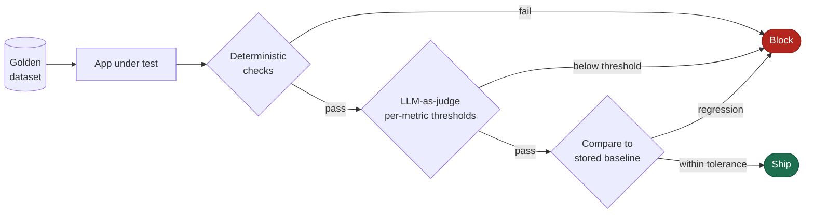

# Bharath Anandaraj

> **I build the evaluation systems that decide whether a model ships.**

10+ years in test engineering and automation architecture; the last four designing quality
infrastructure for AI products — classifiers, LLM report generation, RAG, and agentic systems. The problem
that interests me is the one conventional QA has no answer for: **how do you gate a release when the output
is a probability and a paragraph of clinical prose?**

For the last four years that meant owning quality for a veterinary diagnostic AI platform — 94 production
condition classifiers and an LLM radiology report generator, validated against 300,000+ radiologist-labelled
cases. Per-condition performance is published openly at
**[vetology.net/ai-classifier-performance](https://vetology.net/ai-classifier-performance/)**: median
specificity 92.1%, sensitivity 74.1%, AUC 0.757–0.981.

---

## How a release gets gated

The ordering is the design. Deterministic checks cost nothing and catch an entire class of regression
outright — only what survives them is worth spending an LLM judge on. Inverting that is how eval bills grow
without catching more.

---

## Projects

### [deep_eval_llm_evaluation_framework](https://github.com/bharathanandaraj03/deep_eval_llm_evaluation_framework)

Regression tests for LLM applications, built on DeepEval. Two apps under test: a tool-calling agent, and a
RAG HR assistant (BM25 retrieval over policy documents, Claude generation, FastAPI endpoint).

| | |
|---|---|
| **Suites** | RAG quality · multi-turn conversation · agent tool correctness · safety and scope |
| **Metrics** | 16, each with a documented threshold |
| **Judges** | Pinned by model and version, so scores don't drift when the framework changes its default |
| **CI** | Unit tests on every push; evals on pull requests; HTML report published as an artifact |

*The gate catching a real retrieval failure: contextual relevancy at 0.17 against a 0.7 threshold, with the
judge's reasoning recorded next to every metric. Failed cases sort first and open expanded — a report
nobody has to go archaeology through is a report people actually read.*

### [Playwright_Automated_Test_Framework](https://github.com/bharathanandaraj03/Playwright_Automated_Test_Framework)

TypeScript Playwright framework covering UI and API layers.

| | |
|---|---|
| **Structure** | Page objects over a shared base · API client model · custom fixtures |
| **Performance** | Worker-scoped auth token, one `/auth` call per worker; session reuse via `storageState` |
| **Debugging** | Trace, screenshot and video retained on failure |
| **CI** | Lint and tests gated, report published as an artifact |

---

## Evaluation stack

| Surface | What I measure with |
|---|---|
| **Classifiers** | Confusion matrix, sensitivity / specificity / PPV / NPV, prevalence, AUC; per-condition rather than aggregate, with case-level rollup from image-level results |
| **Generation** | promptfoo, DeepEval, G-Eval, faithfulness, hallucination, summarisation; BLEU / BERTScore for drift, never for gating |
| **RAG** | Contextual precision, contextual recall, contextual relevancy, answer relevancy |
| **Agents** | Task completion, tool correctness, argument correctness, plan adherence, step efficiency — trajectory, not just final answer |
| **Conversational** | Knowledge retention, role adherence, conversation completeness and relevancy |
| **In CI** | pytest-native gates with documented per-metric thresholds, pinned judge models, unit tests split from evals to control cost, reports published as build artifacts |

---

## How I think about evaluation

**Accuracy is a lie at low prevalence.** A condition present in 2% of studies, and a model that outputs
"absent" unconditionally, scores 98%. Any metric a constant function can win is not a metric.

**The shape of a failure carries more information than its rate.** An 88% pass rate scattered across
accuracy and faithfulness means block the release. The same 88% concentrated in one presentational
dimension means ship it with a targeted fix. Same number, opposite decisions — and an aggregate score
destroys exactly the information the decision needed.

**Evaluating an agent is not evaluating its answer.** A correct result reached through the wrong tool call,
or a plan the agent abandoned halfway, is a failure that has not surfaced yet. Trajectory metrics — tool
correctness, plan adherence, step efficiency — catch the class of bug that end-state scoring is blind to by
construction.

**An LLM judge is a model, not a ruler.** Rubric scores from a language model are one model's opinion of
another's output, with their own bias and variance. I hit this directly building the DeepEval suite above:
the built-in PII metric flagged a public HR mailbox as a leak, and the built-in role-violation metric
flagged the bot *refusing* to reveal its system prompt as a violation. Both became custom G-Eval rubrics
with their reasoning written down. **A metric you haven't audited is a gate you don't control.**

**Measure the programme with the same rigour you apply to the product.** This year I modelled my own
automation coverage curve and found the target was unreachable at the current test-case intake rate: the
constraint was intake policy, not automation throughput. Publishing that was worth more than hitting the
number would have been.

---

<b>Systems I've designed at production scale</b> — click to expand

 

| System | What it does |
|---|---|
| **250,000-case classifier regression harness** | Five anatomy and species cohorts; every model release compared against baseline with graded per-classifier verdicts. |
| **Automated confusion-matrix pipeline** | Sensitivity, specificity, PPV, NPV and prevalence per condition — resolving the model version from the registry, rolling image-level results up to case level by majority vote. |
| **Rubric-scored generative evaluation** | Regenerated reports scored against baseline across five clinical dimensions. Validated an LLM provider migration over 996 cases: zero accuracy and zero faithfulness regressions, sole failure mode isolated to severity ordering. |
| **Agentic test-generation pipeline** | Five cooperating agents — orchestrator, researcher, generator, validator, publisher — producing Playwright page objects, specs and fixtures under enforced patterns, gated by compilation, lint and PR review. |
| **LLM-judge ground-truth audit** | Curated labels compared against radiologist findings, catching label rot before it reaches a training set. |
| **One-command model deployment** | A 40-step manual runbook reduced to a single audited command with configuration mutation, sibling-consistency rules and a generated report. |

---

## Background

Test engineer → automation architect → engineering manager, staying hands-on throughout. Veterinary
diagnostic AI; UK retail banking, including PSD2 Strong Customer Authentication and Open Banking work whose
stress-test results went to the FCA; insurance; rail traffic management.

**Building with** — Python · Playwright · pytest · Selenium · DeepEval · promptfoo · Docker · GitHub Actions ·
Jenkins · Azure DevOps · AWS · Azure · SQL

**Domain** — DICOM · PACS · diagnostic AI · LLM and agent evaluation · regulated delivery

---

## Elsewhere

Open to quality architecture and AI/ML quality roles.
